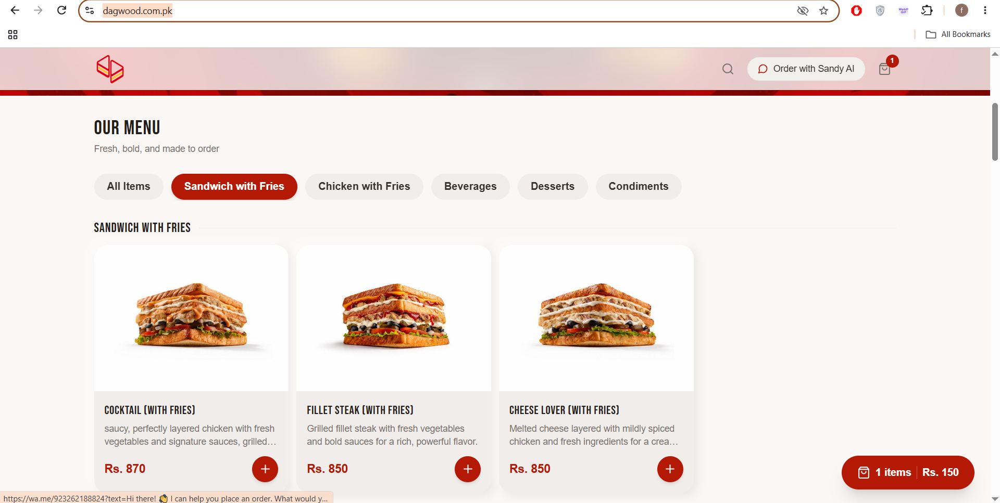

# Assignment 2 — E-commerce Website

## Reference Website

- **Name:** Dagwood
- **URL:** https://dagwood.com.pk/

### Homepage Screenshot

## Project Description
A static, responsive e-commerce website inspired by Dagwood. It includes a product listing homepage and a product detail page.

## Pages
- `index.html` — Homepage with categorized product cards, images, prices, and Add to Cart buttons.
- `product.html` — Product detail page with a larger image, description, quantity selector, and Add to Cart button.

## Technologies Used
- HTML5
- CSS3
- Bootstrap 5
- Flexbox
- Bootstrap responsive grid and media queries

## Features
- Responsive navbar and product grid
- Product cards organized by category
- Circular Add to Cart buttons
- Product image and name linking to the detail page
- Responsive product detail layout
- Consistent footer across both pages

## Screenshots
Add your screenshots of the website at:
- Mobile width: 375px
- Tablet width: 768px
- Desktop width
